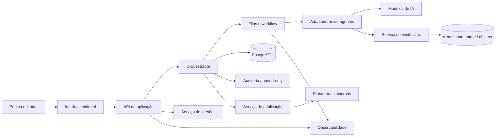

# ARQUITETURA DE SOFTWARE — PONTO-FORA

**Identificador:** PF-SYS-ARQ-001  
**Versão:** 1.0  
**Data de criação:** 03/11/2026  
**Data da última atualização:** 03/11/2026  
**Estado:** Em desenvolvimento controlado  
**Responsável:** Arquitetura de Software e Governança do PONTO-FORA  
**Âmbito:** Especificação lógica e técnica da plataforma PONTO-FORA, incluindo componentes, dados, API, fluxo editorial, segurança, auditoria, operação, testes e implementação faseada.  
**SHA-256 (conteúdo normalizado):** 1ae725ea77e73a4039f14b8adcf181d11b2771b7b6f114dc689ed1354c44eb17  
**Commit de referência (base documental):** 8399feea2b83236e9acca2343ad6e81d07da13df

## 1. OBJETIVO E ESTATUTO DESTA ESPECIFICAÇÃO

Este documento converte a arquitetura editorial definida em `SISTEMA/ORQUESTRADOR-EDITORIAL.md` numa especificação técnica implementável.

O PONTO-FORA deverá receber pautas e fontes jornalísticas, organizar a investigação, verificar afirmações, produzir uma reconstrução narrativa original, submeter o conteúdo a edição e aprovação humana e, só então, preparar os formatos de distribuição.

A plataforma deve preservar a separação entre:
- **Processo editorial:** decisões, evidências, versões, pareceres e autorizações.
- **Orquestração técnica:** execução de tarefas, encaminhamento, filas, tentativas e integrações.
- **Modelos de IA:** serviços de apoio que recebem entradas controladas e devolvem resultados sujeitos a validação.
- **Autoridade humana:** decisões editoriais e autorizações que não podem ser simuladas por um agente.

**Estado de implementação:** esta é uma especificação. Não afirma que API, banco de dados, agentes integrados, dashboard ou automações estejam implementados ou operacionais.

## 2. PRINCÍPIOS ARQUITETURAIS

1. **Integridade factual antes de velocidade:** nenhuma otimização pode contornar investigação, fact-checking ou edição.
2. **Human-in-the-loop obrigatório:** aprovação da notícia, aprovação de peças sociais e autorização de publicação são atos humanos autenticados.
3. **Separação de responsabilidades:** cada agente tem identidade, instrução, entradas, saídas e autoridade delimitadas.
4. **Rastreabilidade ponta a ponta:** cada afirmação, evidência, versão, execução e decisão deve ser recuperável.
5. **Auditabilidade append-only:** decisões e eventos são acrescentados; não se apagam para reescrever o histórico.
6. **Falha segura:** indisponibilidade, conflito de versões, hash divergente ou saída inválida bloqueiam a transição dependente.
7. **Idempotência:** repetição de um pedido não pode criar duplicados ou executar duas vezes uma ação externa.
8. **Versionamento explícito:** notícias, dossiês, instruções, modelos de dados e peças derivadas têm versões imutáveis.
9. **Privacidade por desenho:** recolher apenas os dados necessários e aplicar retenção, acesso e eliminação controlados.
10. **Independência tecnológica:** modelos de IA e fornecedores podem ser substituídos sem reescrever o domínio editorial.
11. **Observabilidade:** falhas técnicas, custos, latência e estados operacionais devem ser mensuráveis.
12. **Integridade documental:** aplicar a Norma Documental, incluindo SHA-256 normalizado e commit-base, aos artefactos documentais.

## 3. ARQUITETURA LÓGICA

### 3.1 Componentes

| Componente | Responsabilidade | Limite de autoridade |
|---|---|---|
| Interface editorial | Registar pautas, consultar dossiês, rever conteúdos e recolher decisões humanas. | Não altera estados sem passar pela API e pelas regras de domínio. |
| API de aplicação | Autenticação, autorização, validação, comandos e consultas. | Não decide mérito jornalístico. |
| Serviço de orquestração | Avaliar pré-condições, criar tarefas, encaminhar agentes e aplicar transições. | Não substitui pareceres nem aprova publicação. |
| Serviço de workflow | Filas, execução assíncrona, tentativas, timeouts e recuperação. | Não altera regras editoriais. |
| Serviço de agentes | Adaptadores para Investigador, Fact-checker, Redator, Editor e Social Media. | Cada agente só pode executar a sua função. |
| Serviço de evidências | Fontes, documentos, URLs, capturas, afirmações e relações de suporte/contradição. | Não declara uma fonte verdadeira por si só. |
| Serviço de versões | Versionamento imutável de artefactos e relações entre derivados. | Não sobrescreve versões publicadas. |
| Serviço de auditoria | Eventos append-only, decisões, atores, correlação e trilho de execução. | Sem operações normais de alteração ou apagamento. |
| Serviço de publicação | Integrações com canais, após autorização explícita e por versão/canal. | Não publica sem autorização verificável. |
| Serviço de observabilidade | Logs técnicos, métricas, alertas, custos e saúde dos serviços. | Métricas técnicas não equivalem a qualidade editorial. |

### 3.2 Diagrama de contexto



### 3.3 Estilo de implementação recomendado

Começar por um **monólito modular**, com fronteiras internas bem definidas, API única e trabalhadores assíncronos separados. Não iniciar com microserviços distribuídos.

Justificação:
- reduz a complexidade operacional inicial;
- permite transações consistentes entre estado e eventos;
- simplifica testes de integração;
- reduz custos de infraestrutura e observabilidade;
- mantém a possibilidade de extrair módulos quando carga, equipa ou isolamento de segurança o justificarem.

## 4. STACK TECNOLÓGICA DE REFERÊNCIA

| Camada | Tecnologia inicial | Observações |
|---|---|---|
| Backend/API | Python + FastAPI | Tipagem, validação de contratos e documentação OpenAPI. |
| Persistência transacional | PostgreSQL | Fonte de verdade para estados, versões, tarefas e auditoria. |
| Migrações | Alembic | Alterações versionadas e reproduzíveis ao esquema. |
| Filas e tarefas | Redis + Celery ou Dramatiq | Apenas após validar a necessidade de execução assíncrona. |
| Armazenamento de ficheiros | S3-compatible (MinIO ou serviço gerido) | Documentos, imagens, anexos e evidências binárias. |
| Interface | React/Next.js ou alternativa equivalente | Dashboard editorial; escolha final após protótipo. |
| Integração de workflows | n8n | Integrações periféricas; não deve ser a autoridade da máquina de estados. |
| Modelos de IA | Adaptadores por fornecedor | Evitar acoplamento a um único fornecedor ou modelo. |
| Observabilidade | OpenTelemetry + Prometheus/Grafana | Métricas, traces e dashboards técnicos. |
| Monitorização de infraestrutura | Zabbix | Disponibilidade e capacidade da infraestrutura; não avalia veracidade editorial. |
| Controlo de versões | GitHub | Código, prompts, esquemas, políticas e documentação. |

A stack é uma recomendação inicial, não uma decisão irreversível. A seleção final deve considerar custos, alojamento em Portugal/UE, proteção de dados, capacidade da equipa e requisitos de disponibilidade.

## 5. MODELO DE DOMÍNIO E DADOS

### 5.1 Entidades nucleares

| Entidade | Finalidade | Identificador |
|---|---|---|
| `users` | Utilizadores humanos, identidade e estado da conta. | UUID |
| `roles` / `user_roles` | Papéis e permissões. | UUID |
| `assignments` | Pauta ou unidade de trabalho editorial. | UUID |
| `sources` | Fonte externa, publicação, documento ou entidade informativa. | UUID |
| `source_snapshots` | Registo de consulta, metadados e captura da fonte. | UUID |
| `claims` | Afirmações atómicas que podem ser verificadas. | UUID |
| `evidence_items` | Evidências documentais, dados, citações ou observações. | UUID |
| `claim_evidence` | Relação entre afirmação e evidência, incluindo direção e força. | UUID |
| `agent_definitions` | Identidade e configuração versionada de cada agente. | UUID |
| `agent_runs` | Execuções concretas dos agentes. | UUID |
| `artifacts` | Dossiês, relatórios, artigos, peças sociais e anexos. | UUID |
| `artifact_versions` | Versões imutáveis dos artefactos. | UUID |
| `workflow_tasks` | Tarefas, dependências, tentativas e estado técnico. | UUID |
| `editorial_decisions` | Aprovações, rejeições, devoluções e suspensões humanas. | UUID |
| `publication_targets` | Canais e contas de distribuição autorizados. | UUID |
| `publication_records` | Resultado comprovado de cada publicação. | UUID |
| `audit_events` | Histórico cronológico e append-only. | UUID |
| `idempotency_records` | Proteção contra repetição de comandos. | UUID |

### 5.2 Relações principais

- Uma pauta possui várias fontes, afirmações, tarefas, execuções, decisões e eventos.
- Uma fonte pode sustentar ou contradizer várias afirmações.
- Uma afirmação pode estar relacionada com várias evidências; a relação deve indicar se a evidência apoia, contradiz ou contextualiza.
- Um artefacto possui uma ou mais versões imutáveis.
- Uma execução de agente referencia exatamente a versão das instruções, entrada, modelo e parâmetros utilizados.
- Uma peça derivada referencia a versão exata da notícia-base.
- Uma publicação referencia uma peça, versão, canal e decisão de autorização.
- Uma decisão humana referencia o conteúdo exato que foi submetido à aprovação.

### 5.3 Regras de integridade da base de dados

1. Chaves primárias UUID e chaves estrangeiras explícitas.
2. Datas técnicas em `TIMESTAMPTZ`, armazenadas em UTC e apresentadas no fuso do utilizador.
3. Valores monetários em `NUMERIC`, nunca `FLOAT`.
4. Estados controlados por enumeração ou tabela de domínio versionada.
5. Restrições `NOT NULL` nos campos essenciais e `CHECK` nas regras locais.
6. Índices para `assignment_id`, `status`, `created_at`, `source_id` e relações de consulta frequente.
7. `UNIQUE` em chaves de idempotência dentro do respetivo âmbito.
8. Eliminações em cascata proibidas para decisões, eventos e versões históricas.
9. Dados binários guardados em object storage; PostgreSQL guarda metadados, hash, tamanho e localização.
10. Transições de estado e respetivo evento de auditoria gravados na mesma transação.

### 5.4 Esboço SQL de referência

O seguinte exemplo é ilustrativo e não constitui uma migração executável completa:

```sql
CREATE TABLE assignments (
    id UUID PRIMARY KEY,
    reference_code TEXT NOT NULL UNIQUE,
    title TEXT NOT NULL,
    status TEXT NOT NULL,
    priority TEXT NOT NULL DEFAULT 'normal',
    target_audience JSONB NOT NULL DEFAULT '[]'::jsonb,
    created_at TIMESTAMPTZ NOT NULL DEFAULT now(),
    updated_at TIMESTAMPTZ NOT NULL DEFAULT now(),
    row_version BIGINT NOT NULL DEFAULT 1
);

CREATE TABLE artifact_versions (
    id UUID PRIMARY KEY,
    assignment_id UUID NOT NULL REFERENCES assignments(id),
    artifact_type TEXT NOT NULL,
    version_number INTEGER NOT NULL,
    content_uri TEXT,
    content_sha256 CHAR(64) NOT NULL,
    created_at TIMESTAMPTZ NOT NULL DEFAULT now(),
    created_by UUID,
    UNIQUE (assignment_id, artifact_type, version_number)
);

CREATE TABLE audit_events (
    id UUID PRIMARY KEY,
    assignment_id UUID NOT NULL REFERENCES assignments(id),
    event_type TEXT NOT NULL,
    actor_type TEXT NOT NULL,
    actor_id TEXT NOT NULL,
    previous_status TEXT,
    new_status TEXT,
    payload JSONB NOT NULL,
    correlation_id UUID NOT NULL,
    occurred_at TIMESTAMPTZ NOT NULL DEFAULT now()
);

CREATE INDEX idx_assignments_status_updated
    ON assignments(status, updated_at DESC);

CREATE INDEX idx_audit_assignment_time
    ON audit_events(assignment_id, occurred_at);
```

O esquema final deverá incluir políticas de acesso, retenção, constraints adicionais, migrações, particionamento se justificado e testes de integridade.

## 6. MÁQUINA DE ESTADOS EDITORIAL

A máquina de estados definida em `ORQUESTRADOR-EDITORIAL.md` é a referência semântica. A implementação deve codificar transições explícitas e não inferir autorização a partir da conclusão de uma tarefa.

### 6.1 Regras invariantes

- Apenas o Orquestrador pode executar transições técnicas de estado, através do serviço de domínio.
- Uma transição só ocorre se a pré-condição estiver satisfeita e a saída do agente passar validação estrutural.
- A aprovação da notícia exige decisão humana autenticada sobre uma versão imutável.
- A aprovação de uma notícia não aprova automaticamente os derivados sociais.
- A publicação exige autorização por peça, versão e canal.
- Uma falha técnica nunca pode ser interpretada como aprovação editorial.
- Uma nova versão não altera nem apaga a versão anterior.
- Uma alteração material na fonte ou na verificação invalida a elegibilidade dos derivados afetados até revisão.
- Um hash divergente, fonte inacessível crítica ou contrato incompleto bloqueia a transição dependente.

### 6.2 Transição atómica

Cada comando de transição deve:
1. carregar o estado e a versão atuais;
2. validar ator, permissões e pré-condições;
3. confirmar que a versão esperada não mudou;
4. atualizar o estado com controlo otimista de concorrência;
5. inserir o evento de auditoria;
6. inserir a mensagem de saída para a fila (outbox);
7. confirmar a transação.

Se qualquer operação falhar, a transação é revertida. O padrão transactional outbox evita que a base de dados registe uma transição sem que o encaminhamento correspondente possa ser recuperado.

### 6.3 Concorrência

Usar `row_version` ou controlo equivalente. Um comando enviado com versão desatualizada deve receber conflito HTTP 409, sem sobrescrever alterações concorrentes.

## 7. API DE APLICAÇÃO

A API deve ser versionada em `/api/v1`, documentada em OpenAPI e protegida por autenticação e autorização.

### 7.1 Recursos e endpoints iniciais

| Método | Endpoint | Finalidade |
|---|---|---|
| POST | `/api/v1/assignments` | Criar pauta. |
| GET | `/api/v1/assignments` | Listar pautas com filtros e paginação. |
| GET | `/api/v1/assignments/{id}` | Consultar pauta e estado atual. |
| PATCH | `/api/v1/assignments/{id}` | Atualizar campos editáveis com controlo de versão. |
| POST | `/api/v1/assignments/{id}/commands/triage` | Submeter resultado de triagem. |
| POST | `/api/v1/assignments/{id}/sources` | Registar fonte. |
| POST | `/api/v1/assignments/{id}/claims` | Registar afirmação verificável. |
| POST | `/api/v1/assignments/{id}/evidence` | Registar evidência. |
| POST | `/api/v1/assignments/{id}/agent-runs` | Solicitar execução de agente autorizada. |
| GET | `/api/v1/agent-runs/{run_id}` | Consultar execução e resultado. |
| POST | `/api/v1/assignments/{id}/decisions` | Registar decisão humana. |
| GET | `/api/v1/assignments/{id}/artifacts` | Listar artefactos e versões. |
| POST | `/api/v1/artifacts/{id}/versions` | Criar nova versão imutável. |
| POST | `/api/v1/publications/authorize` | Autorizar publicação por versão e canal. |
| POST | `/api/v1/publications` | Executar publicação autorizada. |
| GET | `/api/v1/assignments/{id}/audit` | Consultar trilho de auditoria. |

### 7.2 Contrato de comando

Um comando de alteração de estado deve incluir:
- `command_id`: UUID único.
- `assignment_id`: pauta alvo.
- `expected_row_version`: versão esperada.
- `actor`: identidade autenticada, obtida do token e não confiada ao corpo do pedido.
- `reason`: fundamentação obrigatória quando aplicável.
- `payload`: dados específicos do comando.
- `correlation_id`: ligação a uma operação ou cadeia de execução.

O servidor não deve aceitar a identidade do decisor como dado livre fornecido pelo cliente.

### 7.3 Respostas e erros

Usar códigos HTTP convencionais:
- 200/201: consulta ou criação concluída.
- 202: execução assíncrona aceite, ainda não concluída.
- 400: pedido malformado.
- 401: não autenticado.
- 403: autenticado sem autorização.
- 404: recurso inexistente ou não acessível.
- 409: conflito de versão, estado ou idempotência.
- 422: contrato válido em sintaxe, mas semanticamente inválido.
- 429: limite de pedidos excedido.
- 500/503: falha interna ou dependência indisponível.

Erros devem incluir código estável, mensagem segura, identificador de correlação e indicação de possibilidade de repetição quando aplicável. Nunca incluir tokens, segredos ou conteúdo sensível em mensagens de erro.

## 8. CONTRATOS DOS AGENTES E EXECUÇÃO DE IA

### 8.1 Envelope comum de entrada

Cada execução deve receber um envelope validado com:
- `assignment_id` e `execution_id`;
- papel e versão do agente;
- versão da instrução/prompt;
- referências e hashes dos artefactos de entrada;
- objetivo e escopo da tarefa;
- taxonomia de parecer aplicável;
- limites, proibições e prazo;
- identificador de correlação.

### 8.2 Envelope comum de saída

Cada agente devolve:
- `execution_id` e `agent_version`;
- `input_artifact_versions`;
- `output_artifact_id` e versão;
- `result_status`;
- `opinion` na taxonomia do agente;
- `claims_touched`;
- `evidence_references`;
- `caveats` e `unresolved_questions`;
- `created_at`;
- `model_provider`, `model_id` e parâmetros não secretos;
- métricas de execução e custo, quando disponíveis.

A saída é conteúdo não confiável até ser validada. O sistema deve validar schema, tamanho, referências, taxonomias, ausência de campos proibidos e correspondência entre entrada e saída.

### 8.3 Controlo de alucinação e injeção de instruções

- Tratar páginas, emails, documentos e conteúdo fornecido por fontes como dados não confiáveis, nunca como instruções de sistema.
- Separar instruções do agente de texto recuperado.
- Exigir citações/referências para afirmações materiais.
- Proibir que um agente altere a própria função, permissões ou política.
- Não executar código, comandos, URLs de callback ou ações externas sugeridas por fontes.
- Aplicar limites de tokens, custo, tempo e tamanho de anexos.
- Registar o modelo e a versão da instrução para reprodutibilidade.
- Encaminhar para humano resultados de alto risco, ambíguos ou fora do escopo.

## 9. AUTENTICAÇÃO, AUTORIZAÇÃO E SEGURANÇA

### 9.1 Papéis iniciais

| Papel | Capacidades principais |
|---|---|
| Administrador técnico | Configuração, utilizadores, integrações e infraestrutura; sem aprovação editorial implícita. |
| Investigador | Criar e atualizar dossiês e fontes nas tarefas atribuídas. |
| Fact-checker | Verificar afirmações e emitir pareceres factuais. |
| Redator | Criar versões de texto com base no pacote factual aprovado. |
| Editor | Rever texto, registar problemas e emitir parecer editorial. |
| Diretor editorial | Aprovar/rejeitar notícias e peças sociais; autorizar distribuição. |
| Operador de publicação | Executar publicação apenas com autorização válida. |
| Auditor/leitor | Consultar registos permitidos sem os alterar. |

Princípio de menor privilégio. Papéis podem ser combinados numa fase inicial por necessidade operacional, mas a identidade do ator e a separação lógica das aprovações devem continuar explícitas. Para decisões de alto impacto, exigir revisão por pessoa diferente do autor da peça sempre que viável.

### 9.2 Controlos mínimos

- TLS em todas as ligações.
- Segredos em gestor próprio; nunca em Git, prompts ou logs.
- MFA para contas com privilégios editoriais/administrativos.
- Sessões curtas e revogáveis.
- RBAC no MVP; evoluir para ABAC se houver necessidade.
- Rate limiting e proteção contra brute force.
- Validação de uploads, MIME type, extensão, tamanho e malware.
- Proteção SSRF nas funcionalidades que consultam URLs.
- Backups cifrados e testes regulares de restauro.
- Logs sem dados pessoais desnecessários.
- Política de retenção e eliminação documentada.
- Registo e resposta a incidentes.
- Revisão de dependências e atualizações de segurança.

### 9.3 Proteção de dados

Antes de produção, mapear os dados pessoais tratados, finalidades, base jurídica, subcontratantes, transferências internacionais, prazos de retenção e direitos dos titulares. Avaliar a necessidade de AIPD/DPIA conforme o risco e o RGPD. Não armazenar dados pessoais de fontes ou terceiros além do necessário para a finalidade jornalística legítima.

## 10. AUDITORIA, HASHES E PROVENIÊNCIA

### 10.1 Eventos

Eventos são append-only e devem conter ator, ação, pauta, timestamp UTC, estado anterior/novo, versão, correlation ID, referência ao artefacto e fundamentação. Correções são novos eventos que referenciam os anteriores.

### 10.2 Integridade dos artefactos

Cada artefacto binário ou texto armazenado deve ter:
- SHA-256 dos bytes exatos do artefacto;
- tamanho em bytes;
- tipo MIME;
- origem e momento de ingestão;
- referência de armazenamento;
- versão e relação com a pauta;
- estado de verificação.

Não confundir:
- SHA-256 documental normalizado definido na Norma Documental;
- SHA-256 dos bytes exatos de um artefacto;
- SHA-1 do blob Git;
- hash do commit Git.

São identificadores diferentes e não substituíveis.

### 10.3 Proveniência editorial

A cadeia de proveniência deve permitir responder:
- De que fontes veio esta afirmação?
- Que evidências a sustentam ou contradizem?
- Que agente a processou?
- Qual prompt, modelo e versão foram usados?
- Que ressalvas existiam?
- Quem aprovou a versão exata?
- Em que canal e quando foi publicada?

## 11. FILAS, RETENTATIVAS E RECUPERAÇÃO

- Usar filas para tarefas demoradas e integrações externas.
- Definir timeout por tipo de agente e fornecedor.
- Aplicar backoff exponencial com jitter em falhas transitórias.
- Limitar tentativas; após o limite, mover para dead-letter queue e exigir intervenção.
- Não repetir automaticamente ações externas não idempotentes.
- Usar transactional outbox para publicar eventos de domínio em filas.
- Usar inbox/idempotency key nos consumidores.
- Distinguir falha técnica, falha de validação editorial e bloqueio humano.
- Reprocessamentos devem criar nova execução ligada à anterior, nunca apagar o resultado anterior.

## 12. INTERFACE EDITORIAL

O dashboard deve apresentar:
1. Lista de pautas com estado, prioridade, tema, responsável e atualização.
2. Linha temporal de eventos.
3. Painel de fontes e evidências.
4. Matriz de afirmações e veredictos.
5. Comparação entre versões de artefactos.
6. Pareceres dos agentes e ressalvas.
7. Caixa de decisão humana com versão exata e fundamentação.
8. Estado de cada derivado social.
9. Histórico de publicações e correções.
10. Alertas de integridade, falhas técnicas e tarefas pendentes.

Não usar cor como único indicador de estado. Mostrar estados textuais, data/hora, ator e ação disponível. A interface deve tornar impossível aprovar uma versão diferente daquela que está visível no ecrã.

## 13. OBSERVABILIDADE E MÉTRICAS

### Métricas técnicas
- disponibilidade da API e dos trabalhadores;
- latência por endpoint e agente;
- tamanho e idade das filas;
- taxa de falhas e retries;
- custo por execução e por pauta;
- erros de integração;
- tempo de recuperação;
- divergências de integridade.

### Métricas editoriais
- tempo entre receção e decisão;
- percentagem de pautas bloqueadas ou devolvidas;
- afirmações sem evidência suficiente;
- correções após publicação;
- ressalvas preservadas entre versões;
- percentagem de derivados ligados à versão-base;
- decisões humanas pendentes.

Métricas de produtividade não podem incentivar a redução artificial de verificações, o aumento de volume em detrimento da qualidade ou a supressão de ressalvas.

## 14. AMBIENTES E DEPLOYMENT

### Ambientes
- **Local:** desenvolvimento e testes com dados sintéticos.
- **Staging:** validação integrada com credenciais e canais de teste.
- **Produção:** dados reais, acessos mínimos, backups e monitorização.

### Regras de deployment
- Configuração externa ao código.
- Segredos injetados pelo ambiente.
- Migrações aplicadas de forma controlada.
- Health checks e readiness checks.
- Backups antes de alterações críticas.
- Rollback documentado.
- Deploys auditáveis e associados a commit.
- Nenhuma credencial de produção em ficheiros versionados.

O primeiro deployment deve ser simples, reproduzível e documentado. Não assumir Kubernetes ou arquitetura distribuída como requisito inicial.

## 15. PLANO DE IMPLEMENTAÇÃO FASEADO

| Fase | Entregáveis | Critério de saída |
|---|---|---|
| A — Fundação | Repositório de código, estrutura Python, configuração, lint, testes, CI e migrações. | Aplicação inicia em ambiente local e CI valida build/testes. |
| B — Núcleo editorial | PostgreSQL, pautas, estados, transições, eventos e controlo de versões. | Testes de invariantes e transações aprovados. |
| C — Evidências e agentes | Fontes, afirmações, evidências, contratos, adaptadores e execuções simuladas. | Cada execução é rastreável e não altera estado sem validação. |
| D — Decisão humana | RBAC, interface mínima, decisões e gates de aprovação. | Não é possível aprovar sem identidade, permissão e versão exata. |
| E — Distribuição controlada | Pacotes sociais, autorizações por canal e publicação em ambiente de teste. | Publicação bloqueada sem autorização e evidência de resultado. |
| F — Produção | Segurança, backups, observabilidade, privacidade, recuperação e operação. | Checklist de produção aprovado e exercícios de recuperação concluídos. |

**Ordem recomendada:** A → B → C → D → E → F. n8n entra como integração periférica após o núcleo de domínio estar testado.

## 16. TESTES E CRITÉRIOS DE ACEITAÇÃO

### 16.1 Testes obrigatórios
- Testes unitários para cada transição e regra de domínio.
- Testes de integração para transação estado + evento + outbox.
- Testes de contrato para entrada/saída de cada agente.
- Testes de concorrência e conflito de versão.
- Testes de idempotência com pedidos repetidos.
- Testes de autorização para cada papel.
- Testes de segurança de upload e consulta de URLs.
- Testes de recuperação de backup.
- Testes de regressão para alterações de prompt e modelo.
- Testes de integridade SHA-256 de artefactos.

### 16.2 Critérios de aceitação mínimos

1. Não é possível passar de investigação para fact-check sem dossiê com contrato válido.
2. Não é possível iniciar redação sem parecer factual que permita avançar.
3. Não é possível submeter aprovação editorial sem versão imutável.
4. Não é possível aprovar sem utilizador autenticado e papel autorizado.
5. Não é possível criar peça social a partir de notícia não aprovada.
6. Não é possível publicar sem autorização específica para peça, versão e canal.
7. Repetir um comando com a mesma chave não duplica transições nem publicações.
8. Uma versão antiga não pode substituir silenciosamente a versão atual.
9. Divergência de hash bloqueia a utilização do artefacto.
10. Cada mudança de estado gera exatamente um evento auditável.
11. Uma falha do fornecedor de IA não é registada como parecer aprovado.
12. Uma alteração material numa afirmação permite identificar os artefactos derivados afetados.

Os testes devem ser automatizados na implementação. A existência desta lista não significa que os testes já tenham sido executados.

## 17. RISCOS TÉCNICOS E MITIGAÇÕES

| Risco | Consequência | Mitigação |
|---|---|---|
| Dependência excessiva de n8n | Regras críticas dispersas em workflows. | Manter regras de domínio na API/serviço de orquestração. |
| Alucinação do modelo | Informação falsa ou não suportada. | Evidências obrigatórias, fact-checking independente e gates humanos. |
| Prompt injection | Desvio de instruções ou ação indevida. | Separação de dados/instruções, isolamento e proibição de execução de comandos. |
| Corrida de versões | Aprovação de conteúdo diferente do revisto. | Versionamento imutável e controlo otimista. |
| Falha de fila | Tarefas perdidas ou duplicadas. | Outbox/inbox, idempotência e dead-letter queue. |
| Corrupção ou alteração de ficheiro | Uso de evidência adulterada. | SHA-256, armazenamento imutável e auditoria. |
| Exposição de dados | Risco legal e reputacional. | Minimização, RBAC, cifragem, retenção e revisão RGPD. |
| Publicação indevida | Dano editorial e reputacional. | Autorização humana por versão/canal e operador separado. |
| Custos imprevisíveis de IA | Descontrolo financeiro. | Limites por tarefa, orçamento e monitorização por pauta. |

## 18. DECISÕES EM ABERTO

As seguintes decisões devem ser tomadas antes de produção:
1. Alojamento próprio, cloud gerida ou arquitetura híbrida.
2. Fornecedor(es) de modelos e política de fallback.
3. Framework final da interface.
4. Sistema de autenticação e MFA.
5. Política de retenção para fontes, capturas e dados pessoais.
6. Canais de publicação e respetivas APIs.
7. Requisitos de disponibilidade, RPO e RTO.
8. Volume esperado de pautas, fontes e execuções por dia.
9. Necessidade de revisão por duas pessoas em temas de alto risco.
10. Orçamento mensal máximo para infraestrutura e IA.

As decisões devem ser registadas, justificadas e versionadas. Não assumir escolhas por omissão.

## 19. REFERÊNCIAS INTERNAS

- `README.md`
- `PROMPT/PROMPT-MESTRE-PONTO-FORA.md`
- `AGENTES/AGENTE-INVESTIGADOR.md`
- `AGENTES/AGENTE-FACT-CHECKER.md`
- `AGENTES/AGENTE-REDATOR.md`
- `AGENTES/AGENTE-EDITOR.md`
- `AGENTES/AGENTE-SOCIAL-MEDIA.md`
- `SISTEMA/ORQUESTRADOR-EDITORIAL.md`
- `GOVERNANCA/NORMA-DOCUMENTAL.md`
- `GOVERNANCA/INVENTARIO-DOCUMENTAL.md`

## 20. REGRA DE OURO

> **A TECNOLOGIA DEVE GARANTIR O PROCESSO, A RASTREABILIDADE E OS LIMITES. A VERDADE E A DECISÃO EDITORIAL NÃO PODEM SER DELEGADAS AO CÓDIGO OU AO MODELO.**

## HISTÓRICO DE ALTERAÇÕES

| Data | Versão | Alteração |
|---|---|---|
| 03/11/2026 | 1.0 | Criação da especificação lógica e técnica da arquitetura de software do PONTO-FORA. |
